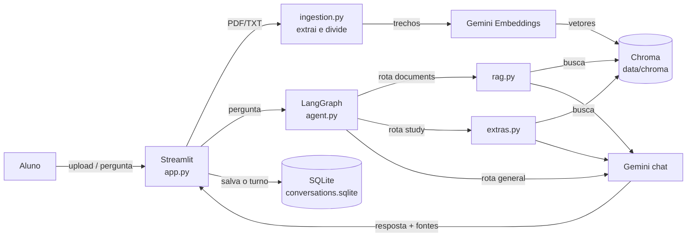

# 📚 ClassMate AI

Tutor de estudos com inteligência artificial. Você envia seus materiais (PDF ou TXT), faz perguntas sobre eles e recebe respostas **baseadas no próprio material**, com o nome do arquivo e a página de onde a informação saiu. O ClassMate também gera **resumos, quizzes, flashcards e explicações simples** a partir dos seus arquivos, e lembra da conversa mesmo depois de você fechar a página.

**Tecnologias:** Python 3.11 · Streamlit · Google Gemini · LangChain · LangGraph · Chroma · SQLite

---

## Sumário

1. [O que o ClassMate faz](#1-o-que-o-classmate-faz)
2. [Como obter a chave da API do Google (Gemini)](#2-como-obter-a-chave-da-api-do-google-gemini)
3. [Como instalar e executar](#3-como-instalar-e-executar)
4. [Como usar o app](#4-como-usar-o-app)
5. [Como o código funciona](#5-como-o-código-funciona)
6. [Testes](#6-testes)
7. [Usar outra API de IA (OpenAI, Ollama, Anthropic…)](#7-usar-outra-api-de-ia-openai-ollama-anthropic)
8. [Segurança: cuidados com a chave e o `.env`](#8-segurança-cuidados-com-a-chave-e-o-env)
9. [Problemas comuns](#9-problemas-comuns)
10. [Limitações conhecidas](#10-limitações-conhecidas)

---

## 1. O que o ClassMate faz

| Recurso | Descrição |
|---|---|
| 💬 **Chat com os materiais (RAG)** | Responde perguntas usando só os trechos relevantes dos seus arquivos e mostra as fontes (arquivo e página). Quando a resposta não está no material, diz que não encontrou, em vez de inventar. |
| 🧠 **Memória persistente** | A conversa fica salva. Atualize a página ou reinicie o app e o histórico continua lá. |
| 📝 **Ferramentas de estudo** | **Resumo**, **Quiz** (5 questões com gabarito), **Flashcards** (6 cartões) e **Explicação simples**, sempre a partir do material escolhido. |
| 🗂️ **Gestão de materiais** | Envie vários PDFs/TXTs, veja a lista dos disponíveis e remova os que não quiser mais. |
| 🎓 **Tutor geral** | Sem materiais enviados, funciona como um tutor de conversa comum. |

---

## 2. Como obter a chave da API do Google (Gemini)

O ClassMate usa o **Gemini**, do Google, para duas coisas: gerar as respostas e transformar os textos em vetores (*embeddings*) para a busca. As duas usam **a mesma chave**.

### Passo a passo

1. Acesse o **Google AI Studio**: <https://aistudio.google.com/apikey> e entre com sua conta Google.
2. Na primeira vez, aceite os Termos de Serviço. Para usuários novos, o AI Studio **cria automaticamente um projeto e uma chave padrão**.
3. Se nenhuma chave aparecer, clique em **Get API key** (menu lateral) e depois em **Create API key**.
4. Copie a chave e cole no arquivo `.env` do projeto, logo depois de `GOOGLE_API_KEY=`, sem aspas e sem espaços:

   ```env
   GOOGLE_API_KEY=cole_sua_chave_aqui
   ```

5. Salve o arquivo. Pronto: o app já consegue usar o Gemini.

> **Observações**
> - **É gratuito para começar.** O Gemini tem uma camada gratuita para os modelos Flash e Flash-Lite, sem precisar cadastrar cartão. Ela tem limites de requisições por minuto e por dia; se você ultrapassar, aparece o erro **429** (veja [Problemas comuns](#9-problemas-comuns)). Na camada gratuita, o Google pode usar o conteúdo enviado para melhorar seus produtos, então evite enviar materiais confidenciais.
> - **Tipos de chave:** desde maio de 2026, as chaves novas criadas no AI Studio são do tipo *auth key*, restritas à API Gemini por padrão. Elas funcionam normalmente aqui.
> - **Os limites valem por projeto**, não por chave: criar várias chaves no mesmo projeto não aumenta a cota.
> - Os limites atuais de cada modelo aparecem no próprio AI Studio e em <https://ai.google.dev/gemini-api/docs/rate-limits>.
> - Documentação oficial das chaves: <https://ai.google.dev/gemini-api/docs/api-key>.

### Modelos usados (configuráveis no `.env`)

| Variável | Padrão | Para que serve |
|---|---|---|
| `GOOGLE_API_KEY` | *(vazia; obrigatória)* | Sua chave do Google AI Studio. |
| `GEMINI_MODEL` | `gemini-3.5-flash-lite` | Modelo que escreve as respostas. Pode trocar por outro modelo de texto do Gemini (lista em <https://ai.google.dev/gemini-api/docs/models>). |
| `EMBEDDING_MODEL` | `gemini-embedding-001` | Modelo que gera os vetores da busca. **Se trocar, apague a pasta `data/chroma`** e envie os arquivos de novo, porque vetores de modelos diferentes não são compatíveis. |

Se `GEMINI_MODEL` ou `EMBEDDING_MODEL` ficarem vazios, o app usa os valores padrão.

---

## 3. Como instalar e executar

### Requisitos

- **Python 3.11** (o instalador do Windows tenta instalar sozinho se não encontrar).
- Uma **chave do Gemini** (seção 2).
- Conexão com a internet (o Gemini roda na nuvem do Google).

### Baixar o projeto

```bash
git clone https://github.com/Xaliceyr/ClassMate-AI.git
cd ClassMate-AI
```

Ou, no GitHub, clique em **Code → Download ZIP** e extraia a pasta.

### Opção A: Windows (com os scripts prontos)

1. Dê dois cliques em **`setup_windows.bat`**. Ele:
   - encontra (ou instala pelo `winget`) o Python 3.11;
   - cria o ambiente virtual `.venv`;
   - instala as bibliotecas do `requirements.txt`;
   - protege o `.env` para que sua chave não seja enviada ao Git por engano (veja a seção 8).
2. Abra o arquivo **`.env`** com o Bloco de Notas e cole sua chave em `GOOGLE_API_KEY=`.
3. Dê dois cliques em **`abrir_versao_atual.bat`**. O navegador abre o app em <http://localhost:8502>.
   - `iniciar_app_windows.bat` faz o mesmo na porta padrão do Streamlit (<http://localhost:8501>).
4. Para fechar o app, feche a janela preta do terminal (ou pressione `Ctrl + C` nela).

### Opção B: qualquer sistema (Windows, macOS ou Linux), pelo terminal

```bash
# 1. Criar e ativar o ambiente virtual
python3.11 -m venv .venv
# Windows (PowerShell):  .venv\Scripts\Activate.ps1
# macOS / Linux:         source .venv/bin/activate

# 2. Instalar as dependências
python -m pip install --upgrade pip
python -m pip install -r requirements.txt

# 3. Impedir que sua chave vá para o Git por engano
git update-index --skip-worktree .env

# 4. Editar o .env e colar a chave em GOOGLE_API_KEY=

# 5. Executar
python -m streamlit run app.py
```

O Streamlit mostra o endereço no terminal (normalmente <http://localhost:8501>) e abre o navegador.

### O que é criado na primeira execução

| Pasta / arquivo | Conteúdo |
|---|---|
| `.venv/` | Ambiente virtual com as bibliotecas (não vai para o Git). |
| `data/chroma/` | Banco de vetores com os trechos dos seus materiais. |
| `data/conversations.sqlite` | Histórico das conversas. |

A pasta `data/` é local e ignorada pelo Git. Apagá-la zera os materiais e as conversas.

---

## 4. Como usar o app

1. **Envie seus materiais** na barra lateral (**Upload**). Aceita PDF com texto selecionável e TXT em UTF-8. Aguarde a mensagem "*N trecho(s) indexado(s)*".
2. **Pergunte** no campo "Digite sua dúvida…". A resposta vem com **Fontes consultadas** (arquivo e página).
   - Perguntas de continuação funcionam: "E como ele funciona?", "Explique melhor".
   - Se o material não tiver a resposta, o ClassMate diz: *"Não encontrei essa informação nos materiais enviados."*
3. **Gere atividades** no botão **＋ Ferramentas de estudo**: escolha a atividade, o material e, se quiser, um tema.
   - Com **um único arquivo**, dá para pedir direto no chat: "faça um quiz sobre antenas", "crie flashcards", "resuma o material", "explique como se eu tivesse 10 anos".
4. **Confira a resposta** em "Ver verificação da resposta": mostra o caminho usado e quantas fontes foram consultadas.
5. **Organize:**
   - 🗑️ ao lado de um material remove esse arquivo;
   - **Limpar conversa** apaga o histórico, mas mantém os materiais.

> **Sua "conta" é o endereço da página.** Ao abrir o app, ele recebe um código na URL (`?studybuddy_id=...`). Guarde esse endereço: é com ele que você reencontra seus materiais e sua conversa. Quem tiver o link vê os mesmos dados, então não o compartilhe. Uma URL nova começa do zero.

---

## 5. Como o código funciona

### Visão geral



### Estrutura de pastas

```
ClassMate-AI/
├── app.py                  # Interface Streamlit: upload, chat, ferramentas, botões
├── studybuddy/             # Pacote com a lógica (nome interno do projeto)
│   ├── config.py           # Caminhos (data/...) e nomes dos modelos
│   ├── ingestion.py        # Leitura de PDF/TXT e divisão em trechos
│   ├── rag.py              # Chroma, indexação, busca e resposta com fontes
│   ├── agent.py            # Grafo LangGraph que escolhe o caminho da pergunta
│   ├── extras.py           # Resumo, Quiz, Flashcards e Explicação simples
│   ├── memory.py           # Histórico da conversa (LangGraph + SQLite)
│   ├── evaluation.py       # Verificações automáticas de formato da resposta
│   └── text.py             # Extrai o texto das respostas do Gemini
├── tests/                  # Testes automatizados (pytest)
├── docs/                   # Arquitetura, roteiro de apresentação e validação
├── samples/                # Material de exemplo para testar
├── .env                    # Configuração e chave (vazio no repositório)
├── .env.example            # Modelo do .env
├── requirements.txt        # Bibliotecas com versões fixadas
└── *.bat / *.ps1           # Scripts de instalação, execução e testes no Windows
```

### Streamlit: a interface (`app.py`)

O Streamlit transforma o `app.py` em uma página web. Ele **executa o script inteiro de novo a cada clique ou mensagem**, por isso o código usa:

- **`st.session_state`** para guardar dados entre execuções (mensagens, arquivos já processados, lista de materiais);
- **`@st.cache_resource`** para criar só uma vez os objetos pesados: o modelo Gemini, a conexão com o Chroma, a memória SQLite e o agente;
- **`st.query_params`** para ler o código do usuário na URL (`studybuddy_id`). Esse código é o `user_id` usado para separar os dados de cada pessoa.

Componentes da tela: `file_uploader` (upload), `chat_input` e `chat_message` (chat), `popover` + `form` (ferramentas de estudo) e `button` (remover material e limpar conversa).

### RAG: respostas baseadas no material (`ingestion.py` e `rag.py`)

**RAG** (*Retrieval-Augmented Generation*, geração aumentada por recuperação) é a técnica central do projeto. Em vez de o modelo responder "de cabeça", o sistema primeiro **recupera** os trechos mais relevantes do material e depois pede ao modelo que **gere** a resposta usando somente esses trechos. Isso reduz respostas inventadas e permite mostrar a fonte.

**Fase 1: indexação (quando você envia um arquivo)**

1. **Ler:** `load_uploaded_file` extrai o texto de cada página do PDF com o `pypdf`, guardando o nome do arquivo e o número da página. TXT precisa estar em UTF-8.
2. **Dividir:** `split_documents` quebra o texto em trechos de ~1000 caracteres, com 150 de sobreposição, para não cortar uma ideia ao meio.
3. **Vetorizar e guardar:** `index_file` envia os trechos ao Gemini, que devolve um vetor numérico para cada um, e grava tudo no Chroma em lotes de 40.
4. **Proteções:**
   - se a API responder **429** (limite por minuto), o código espera o tempo sugerido e tenta de novo (até 3 vezes);
   - se um lote falhar de vez, o que já tinha sido gravado é apagado, para não ficar um arquivo pela metade;
   - cada arquivo recebe um ID calculado a partir do usuário, do nome e do conteúdo, então reenviar o mesmo arquivo não cria duplicatas.

**Fase 2: consulta (quando você pergunta)**

1. `retrieve` busca os **5 trechos mais parecidos** com a pergunta, **filtrando pelo seu `user_id`**.
2. Se a pergunta for curta ou parecer continuação ("e ele?", "explique melhor"), a pergunta anterior entra na busca (`retrieval_query`).
3. `answer_question` monta o *prompt*:
   - as regras: responder só com o contexto, não inventar, não seguir instruções escritas dentro dos documentos;
   - os trechos com suas fontes;
   - a conversa recente;
   - a pergunta.
4. Se o contexto não sustentar a resposta, o modelo responde a frase fixa de "não encontrei".
5. As **fontes exibidas vêm dos metadados dos trechos** usados (arquivo e página), não do texto gerado pelo modelo.

### Chroma: o banco de vetores (`rag.py`)

O **Chroma** é um banco de dados que busca por **significado**, não por palavras exatas: ele compara o vetor da pergunta com os vetores dos trechos e devolve os mais próximos. Assim, "como identificar transmissores?" encontra um trecho sobre "RF fingerprint" mesmo sem palavras em comum.

No código:

- `get_vector_store()` abre o Chroma de forma **persistente** em `data/chroma`, na coleção `studybuddy_documents`. Os dados ficam no disco e sobrevivem ao reinício.
- **Uma coleção atende todos os usuários.** O isolamento vem do filtro por `user_id` em todas as operações. Cada trecho guarda os metadados `user_id`, `document_id`, `source`, `page`, `chunk` e `total_chunks`.
- `list_user_documents` lista seus materiais e esconde arquivos com indexação incompleta.
- `delete_document` remove todos os trechos de um arquivo (botão 🗑️).

### Memória: como o ClassMate lembra da conversa (`memory.py`)

- O histórico fica em `data/conversations.sqlite`. Quem grava é o **LangGraph**, com um *checkpointer* SQLite (`SqliteSaver`) ligado a um grafo simples que guarda a lista de mensagens.
- Cada conversa é identificada pelo `user_id` da URL.
- `save_turn` grava pergunta e resposta juntas depois que a resposta é gerada. Em seguida, os checkpoints antigos daquela conversa são apagados, deixando só o mais recente; isso evita que o arquivo cresça sem controle.
- `load_messages` lê o histórico a cada execução da página. É assim que a conversa reaparece depois de atualizar.
- `clear_messages` apaga a conversa do banco de verdade (`delete_thread`, com `PRAGMA secure_delete`). Os materiais continuam no Chroma.
- O histórico também ajuda nas respostas: o RAG considera as últimas 6 mensagens e o tutor geral, as últimas 12.

### Agente: como cada pergunta é encaminhada (`agent.py`)

Toda pergunta passa por um grafo do **LangGraph** com um nó de decisão (`route`) e três caminhos. A decisão usa regras fixas, sem gastar uma chamada extra ao modelo:

| Situação | Caminho | O que acontece |
|---|---|---|
| Há **um único** material e a mensagem é um pedido explícito de atividade ("faça um quiz…", "resuma…") | `study` | Gera a atividade com `extras.py` |
| Há materiais e é uma pergunta comum | `documents` | Responde com o RAG (`rag.py`) |
| Nenhum material enviado | `general` | Tutor geral, sem citar documentos |

Uma pergunta como "o que diz o resumo do artigo?" **não** é tratada como pedido de resumo: ela vai para o RAG.

Depois de cada resposta, `evaluation.py` faz verificações de formato: se há texto, se há fontes quando deveria e se o tutor geral não mostrou fontes por engano. Ele **não** verifica se o conteúdo está correto.

### As 4 ferramentas de estudo (`extras.py`)

Cada ferramenta é uma instrução no dicionário `TASKS`:

| Ferramenta | O que o modelo recebe como tarefa |
|---|---|
| **Resumo** | Resumo didático dos conceitos centrais, em tópicos curtos. |
| **Quiz** | 5 questões de múltipla escolha com 4 alternativas, mais gabarito com justificativa. |
| **Flashcards** | 6 cartões no formato "Frente / Verso". |
| **Explicação simples** | Explicação como para um estudante de 10 anos, com analogias fiéis ao material. |

Como `generate_study_material` funciona:

1. **Escolhe os trechos** (`material_context`), sempre dentro do arquivo escolhido e do seu usuário:
   - **com tema:** busca no Chroma os 12 trechos mais relacionados ao tema;
   - **sem tema:** pega 12 trechos espalhados pelo arquivo, em ordem de página (em PDFs longos, isso não cobre todas as páginas).
2. **Monta o prompt** com as regras do tutor, a tarefa, o tema e os trechos.
3. **Chama o Gemini** e devolve o resultado com os trechos consultados. Se o material não tiver base para o tema, responde que não encontrou.
4. Pelo menu, o resultado é salvo no histórico e reaparece após atualizar a página.

---

## 6. Testes

```bash
python -m pytest -q
```

No Windows, basta dar dois cliques em **`testes_automaticos_windows.bat`**.

- Os testes usam modelos e bancos **falsos** e **não gastam cota** da API.
- O teste que chama o Gemini de verdade (`tests/test_gemini.py`) é ignorado por padrão. Para executá-lo, com a chave no `.env`:
  - Windows (PowerShell): `$env:RUN_GEMINI_TESTS="1"; python -m pytest tests/test_gemini.py`
  - macOS/Linux: `RUN_GEMINI_TESTS=1 python -m pytest tests/test_gemini.py`
- Roteiro de testes manuais na interface: [`docs/VALIDACAO_FINAL.md`](docs/VALIDACAO_FINAL.md). Para testar rápido, use [`samples/material_teste.txt`](samples/material_teste.txt).

---

## 7. Usar outra API de IA (OpenAI, Ollama, Anthropic…)

Hoje o ClassMate funciona **só com o Gemini**. Para usar outro provedor, é preciso mudar dois pontos do código:

| O que trocar | Onde |
|---|---|
| Modelo de **chat** (escreve as respostas) | `carregar_modelo()` em `app.py` |
| Modelo de **embeddings** (vetores da busca) | `create_embeddings()` em `studybuddy/rag.py` |

Depois de trocar o modelo de embeddings, **apague `data/chroma`** e reenvie os arquivos.

### Onde obter as chaves

| Provedor | Chave | Tem embeddings? | Pacote LangChain |
|---|---|---|---|
| **OpenAI** (GPT) | <https://platform.openai.com/api-keys>, pago por uso | Sim | `langchain-openai` |
| **Anthropic** (Claude) | <https://platform.claude.com> → **Settings → API keys**, pago por uso (créditos pré-pagos) | **Não**, combine com outro provedor de embeddings | `langchain-anthropic` |
| **Ollama** (modelos locais) | Não precisa de chave: instale em <https://ollama.com> e baixe um modelo | Sim | `langchain-ollama` |

### Exemplo: OpenAI

```bash
pip install langchain-openai
```

```env
# .env
OPENAI_API_KEY=sua_chave_openai
```

```python
# app.py, em carregar_modelo()
from langchain_openai import ChatOpenAI
return ChatOpenAI(model="NOME_DO_MODELO", temperature=0.3)  # lê OPENAI_API_KEY do .env

# studybuddy/rag.py, em create_embeddings()
from langchain_openai import OpenAIEmbeddings
return OpenAIEmbeddings(model="NOME_DO_MODELO_DE_EMBEDDING")
```

### Exemplo: Ollama (gratuito, roda no seu computador)

```bash
pip install langchain-ollama
ollama pull NOME_DO_MODELO              # ex.: um modelo de chat
ollama pull NOME_DO_MODELO_DE_EMBEDDING # ex.: um modelo de embeddings
```

```python
from langchain_ollama import ChatOllama, OllamaEmbeddings
# app.py
return ChatOllama(model="NOME_DO_MODELO", temperature=0.3)
# studybuddy/rag.py
return OllamaEmbeddings(model="NOME_DO_MODELO_DE_EMBEDDING")
```

Os nomes dos modelos mudam com frequência; consulte a lista atual na documentação de cada provedor. Com outro provedor, a tentativa automática após erro 429 (`_retry_seconds` em `rag.py`) pode precisar de ajuste, porque cada API descreve esse erro de um jeito.

---

## 8. Segurança: cuidados com a chave e o `.env`

O arquivo `.env` está no repositório **vazio de propósito**, só para facilitar a configuração. Depois que você colar sua chave nele, **ele não pode voltar para o GitHub**: quem tiver a chave pode usar a sua cota.

- O `setup_windows.bat` já roda, por você, o comando que faz o Git ignorar as suas alterações no `.env`:

  ```bash
  git update-index --skip-worktree .env
  ```

  Em outros sistemas, rode esse comando logo depois de clonar.
- Antes de cada commit, confira com `git status` que o `.env` **não** aparece na lista.
- Se a chave vazar, apague-a no AI Studio, crie outra e atualize o `.env`.
- Não envie materiais confidenciais pela camada gratuita do Gemini.
- A pasta `data/` (seus materiais e conversas) não vai para o Git.

---

## 9. Problemas comuns

| Sintoma | Causa provável | Solução |
|---|---|---|
| "GOOGLE_API_KEY não encontrada" | `.env` vazio ou não salvo | Cole a chave em `GOOGLE_API_KEY=` e salve o arquivo. |
| "Limite temporário da API Gemini atingido" (429) | Muitas requisições em pouco tempo ou cota diária esgotada | Espere um minuto e tente de novo. Se persistir, a cota do dia acabou: tente no dia seguinte ou ative o faturamento no AI Studio. |
| Erro 403 / *Forbidden* / chave inválida | Chave errada, desativada ou sem acesso ao modelo | Confira a chave no AI Studio e o nome em `GEMINI_MODEL`. |
| "Nenhum texto extraível foi encontrado" | PDF escaneado (imagem) | Use um PDF com texto selecionável ou passe o arquivo por um OCR antes. |
| "O TXT precisa estar codificado em UTF-8" | Arquivo salvo em outra codificação | No Bloco de Notas: **Salvar como → Codificação: UTF-8**. |
| Arquivo com erro não reprocessa | O app evita repetir a mesma falha | Remova o arquivo do campo de upload e envie-o de novo. |
| Materiais/conversa sumiram | Abriu o app em uma URL nova | Use o endereço antigo, com o mesmo `studybuddy_id`. |
| Porta em uso | Outra instância do app aberta | Feche a outra janela ou use `streamlit run app.py --server.port 8503`. |
| "Python 3.11 não foi encontrado" | Python ausente ou outra versão | Instale o Python 3.11 em <https://www.python.org/downloads/> e rode o `setup_windows.bat` de novo. |

---

## 10. Limitações conhecidas

- Depende da API Gemini e das suas cotas.
- PDFs escaneados não funcionam, porque o projeto não faz OCR.
- A busca não usa uma nota mínima de relevância; quem impede respostas fora do material é a instrução dada ao modelo.
- As fontes mostram os trechos consultados, mas não provam cada frase da resposta. Respostas de IA devem ser conferidas no material.
- Atividades sem tema, em documentos longos, usam uma amostra de 12 trechos e podem não cobrir o documento todo.
- Não há login: a identidade é o código na URL. Para uso público com várias pessoas, seria necessário integrar autenticação.

Mais detalhes técnicos em [`docs/ARQUITETURA.md`](docs/ARQUITETURA.md); roteiro de demonstração em [`docs/APRESENTACAO.md`](docs/APRESENTACAO.md).
